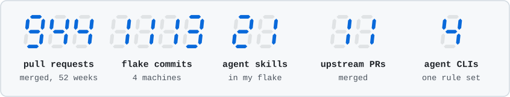

<picture>
  <source media="(prefers-color-scheme: dark) and (min-width: 1280px)" srcset="assets/capture-dark.svg">
  <source media="(prefers-color-scheme: light) and (min-width: 1280px)" srcset="assets/capture-light.svg">
  <source media="(prefers-color-scheme: dark)" srcset="assets/capture-dark-narrow.svg">
  <source media="(prefers-color-scheme: light)" srcset="assets/capture-light-narrow.svg">
  
</picture>

I'm Omer Faruk Oruc, an embedded software engineer in İzmir, Türkiye .

Code that compiles proves nothing to me until I watch it run on a board. That habit comes from firmware. Now coding agents write most of my code under rules I wrote.

- [linctl](https://github.com/KyaniteHQ/linctl) is a Linear CLI you can give to an agent. The agent reads widely and writes to one team, and linctl checks every write against the live credential. There is no bypass flag.
- [nixos-config](https://github.com/OmerFarukOruc/nixos-config) is my desktop, two laptops and a server in one flake. Its `agents/` folder holds the rules, skills and hooks my agents work under. I wrote it for my own machines, so read it and copy the parts you need.
- [threadsift](https://github.com/KyaniteHQ/threadsift) is a reading library for the links I save and never get back to. An agent keeps the useful parts.
- [esp32-ntag424-terminal](https://github.com/OmerFarukOruc/esp32-ntag424-terminal) is ESP32-S3 firmware that writes NTAG424 DNA tags with a PN532 and onboards over BLE.

### Tech stack

**Embedded and systems** 

**Languages** 

**Web and apps** 

**AI and agents** 

**Infrastructure** 

<picture>
  <source media="(prefers-color-scheme: dark) and (min-width: 1280px)" srcset="assets/readouts-dark.svg">
  <source media="(prefers-color-scheme: light) and (min-width: 1280px)" srcset="assets/readouts-light.svg">
  <source media="(prefers-color-scheme: dark)" srcset="assets/readouts-dark-narrow.svg">
  <source media="(prefers-color-scheme: light)" srcset="assets/readouts-light-narrow.svg">
  
</picture>

<picture>
  <source media="(prefers-color-scheme: dark) and (min-width: 1280px)" srcset="assets/year-dark.svg">
  <source media="(prefers-color-scheme: light) and (min-width: 1280px)" srcset="assets/year-light.svg">
  <source media="(prefers-color-scheme: dark)" srcset="assets/year-dark-narrow.svg">
  <source media="(prefers-color-scheme: light)" srcset="assets/year-light-narrow.svg">
  
</picture>

<picture>
  <source media="(prefers-color-scheme: dark) and (min-width: 1280px)" srcset="assets/bus-dark.svg">
  <source media="(prefers-color-scheme: light) and (min-width: 1280px)" srcset="assets/bus-light.svg">
  <source media="(prefers-color-scheme: dark)" srcset="assets/bus-dark-narrow.svg">
  <source media="(prefers-color-scheme: light)" srcset="assets/bus-light-narrow.svg">
  
</picture>

Turkish (native) · English (C1, Academic IELTS 7.0) · French (basic)

With partners I build [Kyanite Labs](https://kyanitelabs.com), a software studio, and [Status Lantern](https://github.com/StatusLantern), which watches U.S. immigration court cases and emails you when one changes. I am on [LinkedIn](https://www.linkedin.com/in/omerfarukoruc/).
